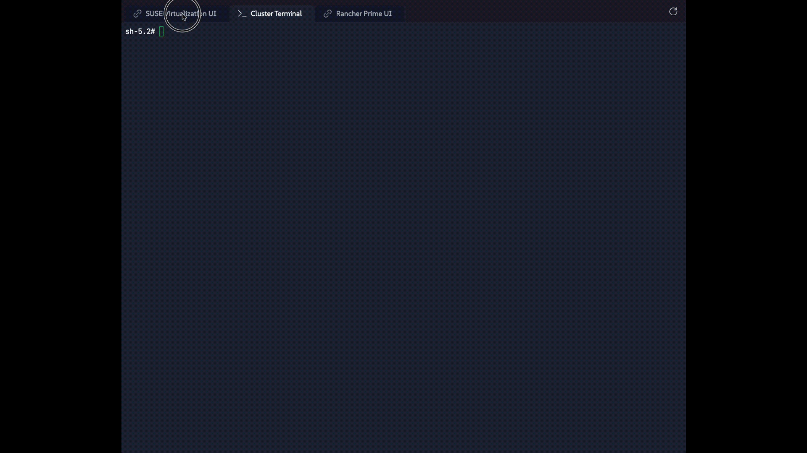

<span id="assignment.9" lang="zh-TW" hist="vertrex-bank">🏦 第一章：抵達</span>
==========================

<style type="text/css">
  * {
    font-family: suse;
    src: url('https://fonts.google.com/specimen/SUSE');
  }
  .suse { color: #30ba78; }
  .virt { color: #30ba78; }
  .bank { color: #d4af37; }
  .danger { color: #ff4d4d; font-weight: bold; }
  .hovereffect {
    border-radius: 25px 25px 25px 25px;
    background: linear-gradient(#30ba78 0 0) var(--hundredpercent, 0) / var(--hundredpercent, 0) no-repeat;
    transition: 0.5s, background-position 0s;
    padding: 5px;
  }
  .hovereffect:hover {
    --hundredpercent: 100%;
    color: white;
    border-radius: 10px 25px 10px 25px;
  }
  .story {
    border-left: 5px solid #d4af37;
    border-radius: 0 15px 15px 0;
    background: linear-gradient(135deg, rgba(48,186,120,.10), rgba(212,175,55,.10));
    padding: 15px 20px;
    margin: 15px 0;
  }
  .story em { color: #d4af37; }
  .missionbox {
    border: 2px dashed #30ba78;
    border-radius: 15px;
    padding: 12px 18px;
    margin: 15px 0;
  }
  .highlightcopy { color: white; font-weight: bold; padding: 0 10px; }
  img.logos { border-radius: 10px; }
  /* compact credential boxes (scoped: only code blocks inside <div class="cred">) */
  .cred > div { margin: 0; }
  .cred .my-3 {
    display: flex;
    flex-direction: row-reverse;   /* put the copy bar on the right */
    align-items: stretch;
    width: fit-content;
    min-width: 14em;
    margin: 4px 0;
    overflow: hidden;
  }
  .cred .my-3 > div:first-child {  /* the bar holding the copy button */
    height: auto;
    padding: 2px 8px;
    border-bottom: none;
    border-left: 1px solid white;
    border-radius: 0;
    display: flex;
    align-items: center;
    background-color: #30ba78;   /* new: green copy-bar background */
  }
  .cred .my-3 > div:first-child,
  .cred .my-3 > div:first-child * {
    color: #fff !important;
  }
  .cred .my-3 > div:first-child:hover,
  .cred .my-3 > div:first-child:hover * {
    font-weight: bold;
  }

  .cred .my-3 > pre {
    flex: 1 1 auto;
    margin: 0 !important;
    padding: 2px !important;
    border-radius: 0 !important;
    display: flex;
    align-items: center;
  }

  img.animatedgif {
    --borderthickness: 5pt;
    --colors: #0000 25%,#30ba78 0;
    padding: 10px;
    background:
      conic-gradient(from 90deg  at top    var(--borderthickness) left  var(--borderthickness),var(--colors)) 0    0,
      conic-gradient(from 180deg at top    var(--borderthickness) right var(--borderthickness),var(--colors)) 100% 0,
      conic-gradient(from 0deg   at bottom var(--borderthickness) left  var(--borderthickness),var(--colors)) 0    100%,
      conic-gradient(from -90deg at bottom var(--borderthickness) right var(--borderthickness),var(--colors)) 100% 100%;
    background-size: 50px 50px;
    background-repeat: no-repeat;
    transition: 1s;
  }

  img.animatedgif:hover {
    background-size: 51% 51%;
  }

  .embedded_img {
    width: 100%;
    height: auto;
    max-height: 1.5vh;
    max-width: 1.5vh;
    margin: 0;
    padding: 0;
    display: inline-block;
  }

</style>


<div id="101" class="story">
<span lang="zh-TW" id="ch1.intro1" hist="vertrex-bank">大雨猛烈敲打著 Vertex Trust Bank 總部的落地窗，將城市天際線扭曲成一片灰濛濛的水漬殘影。在玻璃帷幕的高階主管會議室內，氣氛同樣波濤洶湧。技術長 Sarah 在會議室內來回踱步，雙眼緊盯著上方懸掛的巨大螢幕，上面正投射出滿滿一片紅色警報與效能警告。

她轉向您，疲憊的聲音中帶著緊繃：*「我們在每一筆市場交易中都正在損失寶貴的毫秒。我們的舊型 <span id="ch1.intro1.1" lang="nolang" no>hypervisor</span>s 在現代數位銀行龐大的流量重壓下已不堪重負。基礎架構脆弱不堪，儲存陣列頻繁失去同步，而授權費用更是把我們的工程預算榨得一滴不剩。我們無法再被這些龐大臃腫、過時陳舊的系統束縛著苟延殘喘一年了。」*

您安靜地坐在紅木會議桌的末端，審視著她提供的架構圖。身為頂尖的**基礎架構架構師**，您被延攬至此只有一個明確目的：拯救 Vertex Trust Bank 免於陷入徹底的營運癱瘓。他們需要一座通往雲端原生世界的橋樑，同時又不必從零開始重建整個應用程式堆疊。

*「我們已經有計畫了，Sarah，」*您終於開口，伴隨著一聲令人安心的「喀嗒」聲闔上筆記型電腦。*「我們將把整個資料中心轉移至 <span id="ch1.intro1.2" lang="nolang" no>SUSE Virtualization</span>。我們會帶領你們的舊系統邁入現代化時代，而且一切都會無縫接軌、順暢無阻。」*</span>
</div>


<span id="assignment.2" lang=zh-TW no>您的旅程現在正式展開。在開始瓦解舊世界之前，您需要在新世界中站穩腳跟，並深入探索該環境。


## 什麼是 <span id="ch1.intro1.2" lang="nolang" no>SUSE Virtualization</span>？

<span id="ch1.intro1.2" lang="nolang" no>SUSE Virtualization</span>（亦稱為 **<span id="assignment.2.1" lang="nolang" no>Harvester</span>**）是建置於 <span id="assignment.2.2" lang="nolang" no>Kubernetes</span> 之上的現代化開源超融合基礎架構（HCI）平台。它直接在裸機上運作，並在雲端原生基礎上為銀行提供企業級的**虛擬機器**，<span id="ch1.intro2"  lang="zh-TW" hist="vertrex-bank">正是 Vertex Trust Bank 所需要的橋樑</span>：

- **<span id="assignment.2.3" lang="nolang" no>KubeVirt</span> + <span id="assignment.2.4" lang="nolang" no>KVM</span>/<span id="assignment.2.5" lang="nolang" no>QEMU</span>**：作為原生 <span id="assignment.2.2" lang="nolang" no>Kubernetes</span> 工作負載的企業級虛擬化。底層採用了數十年來為 <span id="assignment.2.6" lang="nolang" no>Linux</span> 虛擬化提供支援、久經沙場的相同 **<span id="assignment.2.4" lang="nolang" no>KVM</span>/<span id="assignment.2.5" lang="nolang" no>QEMU</span>** 組合，這也是該平台能夠執行種類極為廣泛的客體作業系統的原因，<span id="ch1.intro3"  lang="zh-TW" hist="vertrex-bank">包括那些仍在銀行最布滿灰塵的舊系統角落中服役、耐心等待遷移的極老舊系統</span>
- **<span id="assignment.2.7" lang="nolang" no>SUSE Storage</span> (<span id="assignment.2.8" lang="nolang" no>Longhorn</span>)**：跨每個節點的分散式、具複本區塊儲存，開箱即用。<span id="ch1.intro4"  lang="zh-TW" hist="vertrex-bank">而如果銀行日後偏好不同的儲存方式</span>，**任何與 <span id="assignment.2.9" lang="nolang" no>CSI</span> 相容的儲存驅動程式皆可隨插即用**，自由選擇，絕不受限
- **<span id="assignment.2.10" lang="nolang" no>Software-defined networking</span>**：無需動到任何一條線路，就能建立 VLAN 與隔離的覆蓋網路
- **單一開源帳單**：沒有按插槽計算的 <span id="ch1.intro1.1" lang="nolang" no>hypervisor</span> 稅
- **真正傾聽意見的 <span id="assignment.2.11" lang="nolang" no>Support</span>**：SUSE 客戶一貫將 **SUSE <span id="assignment.2.11" lang="nolang" no>Support</span>** 評為業界最佳之一，而且他們的意見回饋直接形塑了產品未來的發展方向。試著向閉源廠商爭取在決策桌上的席位看看

因為該平台運作*在* <span id="assignment.2.2" lang="nolang" no>Kubernetes</span> 之上，容器化工作負載可以在完全相同的叢集上執行。從第一天起就明確劃分職責：<span id="ch1.intro1.2" lang="nolang" no>SUSE Virtualization</span> 使用者介面負責管理**虛擬機器**；而管理容器（以及管理整個叢集機群）則是 <span id="assignment.2.12" lang="nolang" no>**Rancher Prime**</span> 的工作，您稍後就會見到它。

<span id="ch1.intro5"  lang="zh-TW" hist="vertrex-bank">每個榨乾銀行預算的專有元件，都有現代化的開源替代方案：</span>

| 舊世界（按插槽授權） | <span id="ch1.intro1.2" lang="nolang" no>SUSE Virtualization</span> |
|--------------------------------------|---------------------|
| ISAware 專有 <span id="ch1.intro1.1" lang="nolang" no>hypervisor</span> | <span id="assignment.2.3" lang="nolang" no>KubeVirt</span> + <span id="assignment.2.4" lang="nolang" no>KVM</span> |
| 專有儲存陣列 |  SUSE Storage，或任何 <span id="assignment.2.9" lang="nolang" no>CSI</span> 驅動程式 <span id="ch1.intro6"  lang="zh-TW" hist="vertrex-bank">（由銀行自行選擇）</span> |
| 閉源 SDN | <span id="assignment.2.13" lang="nolang" no>Kube-OVN</span> + <span id="assignment.2.14" lang="nolang" no>Multus</span> |
| ISAware Command Throne | <span id="assignment.2.15" lang="nolang" no>SUSE Rancher Prime</span> |

無廠商綁定。無虛擬化稅。無專有核心。**單一平台，單一帳單**，<span id="ch1.intro7"  lang="zh-TW" hist="vertrex-bank">正是您在董事會議室答應 Sarah 的事</span>。


## 🎯 您的任務目標

1. 登入並檢視統一儀表板
2. 認識指揮中心 Rancher Prime！
3. 驗證分散式儲存架構
4. 測試您的管理終端機存取權限


<span id="ch1.intro8"  lang="zh-TW" hist="vertrex-bank">> [!NOTE]
> 免責聲明：本實驗僅供教育用途，並非提供如何為「銀行」設定正式環境的指引，所做出的大多數決策皆是基於本環境的限制與目的。</span>


🔐 登入憑證
=============================

供您記錄留存，您的架構師認證資訊如下：</span>


<span id="assignment.10" lang="nolang" no>Username</span>:

<div class="cred">

```txt
admin
```

</div>

<span id="assignment.11" lang="nolang" no>Password</span>:

<div class="cred">

```txt
[[ Instruqt-Var key="RANCHER_PASSWORD" hostname="kvm-host" ]]
```

</div>


<span id="assignment.3" lang=zh-TW> [!NOTE]
> 使用者介面使用的是自我簽署憑證。當瀏覽器出現安全性警告時，請選擇接受。如果頁面沒有立即載入，實驗室環境可能仍在開機中。請稍等一分鐘並重新整理分頁。

> [!NOTE]
> 如果您偏好在自己的瀏覽器中操作，而非使用嵌入式分頁，可以直接透過以下網址連線至實驗室主機：
> https://kvm-host.[[ Instruqt-Var key="_SANDBOX_ID" hostname="kvm-host" ]].instruqt.io:8443


📊 任務 1：登入並檢視統一儀表板
===================================================

導覽至</span> [button label="SUSE Virtualization UI" variant="success"](tab-0) <span id="assignment.4" lang=zh-TW>分頁並使用您的憑證登入。



花點時間看一下主要</span>  <span id="assignment.5" lang="nolang" no>**Dashboard**</span><span id="assignment.6" lang=zh-TW>：這是您進行整個任務的指揮中心。


> [!NOTE]
> 請先不要進行任何變更。我們目前只是先熟悉環境。


- 第一個區塊是整體統計數字：
  - 組成叢集的 **<span id="assignment.6.1" lang="nolang" no>Hosts</span>**
  - **<span id="assignment.6.2" lang="nolang" no>Virtual Machines</span>**（執行中與已停止）
  - 可用於部署新虛擬機器的 **<span id="assignment.6.3" lang="nolang" no>Images</span>**
  - 使用中的 **<span id="assignment.6.4" lang="nolang" no>Volumes</span>**
  - 可用的 **<span id="assignment.6.5" lang="nolang" no>Disks</span>**

按一下其中任一項，就會前往有更多資訊的專屬區塊。按一下 **<span id="assignment.6.1" lang="nolang" no>Hosts</span>**：

您會看到每個主機已保留與已使用資源的詳細檢視，以及主機的 IP 位址和其他詳細資料。

請注意每列末端的三個垂直點圖示：按一下會開啟該主機的各種操作選單。

回到 **<span id="assignment.6.6" lang="nolang" no>Dashboard</span>**，看看那裡還有什麼：

- 第二個區塊 **<span id="assignment.6.7" lang="nolang" no>Capacity</span>** 列出了叢集中目前已保留及可用的資源。

- 其下方是一個包含兩個分頁的區塊：

  - **<span id="assignment.6.8" lang="nolang" no>Cluster Metrics</span>**：關於叢集的即時指標；這些在疑難排解效能問題時非常有用。

  - **<span id="assignment.6.9" lang="nolang" no>Virtual Machine Metrics</span>**：虛擬機器的即時指標；請注意，如果沒有任何虛擬機器在執行，則不會顯示任何資料。

- 位於底部的最後一個區塊 **<span id="assignment.6.10" lang="nolang" no>Events</span>**，顯示了叢集中發生的最新事件。

現在進一步檢視 UI 的其他部分。右上角有一個已選取 **All Namespaces** 的下拉式選單。它讓您可以聚焦於特定的 namespace。這裡的 namespace 是指 <span id="assignment.2.2" lang="nolang" no>Kubernetes</span> namespace：一種用來組織資源並為其內部所有物件指派專屬權限的方法，概念類似於「群組」。在本章底部，您會找到提供更多資訊的連結；許多您在 <span id="assignment.2.2" lang="nolang" no>Kubernetes</span> 中學到的概念都可以直接套用至 <span id="ch1.intro1.2" lang="nolang" no>SUSE Virtualization</span>。

**鈴鐺圖示**包含通知和警示，再往右的**使用者圖示**則會引導您前往使用者設定以及自動化存取所需的金鑰。

左側是一欄包含不同區塊的導覽列。我們現在不會逐一介紹所有區塊。您將在後續章節中探索其中的許多部分。請注意，這些區塊會根據啟用或停用哪些外掛程式而有所改變。

最後，按一下左下角的 **<span id="assignment.2.11" lang="nolang" no>Support</span>**。
它會將您導向包含文件連結和其他支援資源的頁面，外加兩個重要的區塊：

- **<span id="assignment.6.11" lang="nolang" no>Generate a <span id="assignment.2.11" lang="nolang" no>Support</span> Bundle</span>**：產生一個檔案，協助 SUSE <span id="assignment.2.11" lang="nolang" no>Support</span> 疑難排解您的環境，而無需直接存取它。
- **<span id="assignment.6.12" lang="nolang" no>Download KubeConfig</span>**：提供 kubeconfig 檔案，讓您可以透過主控台使用 kubectl 和其他工具來管理此叢集。

如果您還有時間，請在繼續進行下一項任務之前熟悉這些區塊。


> [!NOTE]
> 您在此儀表板中看到的所有內容（VM、磁碟區、網路），底層都是 <span id="assignment.2.2" lang="nolang" no>Kubernetes</span> 資源。UI 是您進行此任務的主要工具；如果您對其內部運作感到好奇，終端機也已就緒，可供進行選做的加碼練習。


🐮 任務 2：認識指揮中心 Rancher Prime
=================================================

該平台也可以連線至 **Rancher Prime**，<span id="ch1.task2a"  lang="zh-TW" hist="vertrex-bank">而釐清在銀行的新世界裡由誰負責什麼，至關重要：</span>

- <span id="ch1.intro1.2" lang="nolang" no>SUSE Virtualization</span> 管理此叢集上的**虛擬機器**。
- **Rancher Prime** 則**同時管理多個叢集**（每個分行資料中心中的每個 <span id="ch1.intro1.2" lang="nolang" no>SUSE Virtualization</span> 叢集），加上集中式的**使用者、角色和存取控制 (<span id="assignment.6.13" lang="nolang" no>RBAC</span>)**，以及銀行將與其虛擬機器並行執行的**容器工作負載**。

讓我們看看 Rancher 裡面有什麼。

開啟 [button label="Rancher Prime UI" variant="success"](tab-2)，使用相同的認證登入，然後從左側選單中選取 **Virtualization Management**。


  


您可以從這裡管理多個 <span id="ch1.intro1.2" lang="nolang" no>SUSE Virtualization</span> 叢集。匯入現有的叢集：

1. 按一下 **Import Existing**
2. 將 **Cluster Name** 設定為


```txt
mysusevirt1
```


3. 按一下 **Create**
4. 出現新畫面。上面會顯示一個 URL，複製該 URL 以供後續步驟使用。
5. 在其下方您可以看到註冊指示。依照指示操作，並記得在編輯 cluster-registration-url 設定時選取 **<span id="assignment.6.14" lang="nolang" no>Insecure Skip TLS Verify</span>**。這一步要在 [button label="SUSE Virtualization UI" variant="success"](tab-0) 中完成。

6. 切換回 [button label="Rancher Prime UI" variant="success"](tab-2)，然後按一下 UI 左上角的「<span id="assignment.2.1" lang="nolang" no>Harvester</span> Clusters」。

請注意叢集名稱旁邊的狀態：**<span id="assignment.6.15" lang="nolang" no>Pending</span>**。它正在等待叢集完成註冊流程。

留在 Rancher UI 中，觀察狀態從 **<span id="assignment.6.15" lang="nolang" no>Pending</span>** 變更為 **<span id="assignment.6.16" lang="nolang" no>Waiting</span>**，最後變成 **<span id="assignment.6.17" lang="nolang" no>Active</span>**。

現在回到 **<span id="assignment.2.1" lang="nolang" no>Harvester</span> Clusters**：叢集會出現在清單中。

讓我們看看您還可以在這裡做些什麼。按一下該叢集那一列末端的三個垂直點圖示，會展開一個包含數個選項的下拉選單：

- **<span id="assignment.6.18" lang="nolang" no>Kubectl Shell</span>**：開啟連線至叢集的 shell，您可以在其中對其執行 kubectl 指令。
- **<span id="assignment.6.12" lang="nolang" no>Download KubeConfig</span>**：與您在 <span id="ch1.intro1.2" lang="nolang" no>SUSE Virtualization</span> UI 中看到的內容相同。
- **<span id="assignment.6.19" lang="nolang" no>Download YAML</span>**：下載 YAML 格式的叢集定義；您可以將其作為範本，以自動化方式匯入新叢集（這在叢集 UI 中還需要一個額外步驟）。

最後，按一下叢集名稱本身
- 它會將您帶入內嵌於 Rancher UI 中的 <span id="ch1.intro1.2" lang="nolang" no>SUSE Virtualization</span> UI
- 請注意左側欄的選單中出現了一個「<span id="assignment.6.13" lang="nolang" no>RBAC</span>」項目，我們可以控制誰可以在我們的叢集上執行哪些操作。


透過 Rancher，您可以輕鬆地從單一位置操作多個叢集。


> [!NOTE]
> SUSE Rancher Prime 有專屬的 rodeo 活動，歡迎隨時參加！


⌨️ 任務 3：測試您的管理終端機存取權限
===================================================

您將在此任務的大部分時間中使用 UI，<span id="ch1.task3a"  lang="zh-TW" hist="vertrex-bank">但架構師總是會驗證其緊急存取權限</span>。按一下 [button label="Cluster Terminal" variant="success"](tab-1) 分頁並執行一個指令，以檢查您與底層 <span id="assignment.2.2" lang="nolang" no>Kubernetes</span> 引擎的連線是否處於作用中狀態：


```bash,wrap,run
kubectl --kubeconfig .rodeo/harvester-kubeconfig get VirtualMachine -A
```

您應該會看到存在於每個 namespace 中的 <span id="assignment.6.2" lang="nolang" no>Virtual Machines</span> 清單。


💾 加碼練習：驗證分散式儲存網狀架構（選做）
====================================================================

<span id="ch1.bonus1a"  lang="zh-TW" hist="vertrex-bank">健全的儲存後端是銀行營運的關鍵</span>。<span id="ch1.intro1.2" lang="nolang" no>SUSE Virtualization</span> 使用 **<span id="assignment.2.7" lang="nolang" no>SUSE Storage</span>** 在整個叢集中複寫每個磁碟區。


  


[button label="SUSE Virtualization UI" variant="success"](tab-0) 已經顯示了儲存健全狀況的相關資訊，但也可以透過啟用 **Extension developer features** 來存取 <span id="assignment.2.7" lang="nolang" no>SUSE Storage</span> (<span id="assignment.2.8" lang="nolang" no>Longhorn</span>) 儀表板：

1. 按一下右上角您的**使用者圖示**
2. 選取 **Preferences**
3. 勾選 **Enable Extension developer features**

回到 **Home**，然後在左下角按一下 **<span id="assignment.2.11" lang="nolang" no>Support</span>**。

您現在將看到兩個新區塊：

- **<span id="assignment.6.20" lang="nolang" no>Access Embedded</span> Rancher UI**
- **<span id="assignment.6.20" lang="nolang" no>Access Embedded</span> <span id="assignment.2.7" lang="nolang" no>SUSE Storage</span> (<span id="assignment.2.8" lang="nolang" no>Longhorn</span>) UI**

按一下 **<span id="assignment.2.8" lang="nolang" no>Longhorn</span> UI** 區塊。

它將引導您前往 <span id="assignment.2.7" lang="nolang" no>SUSE Storage</span> <span id="assignment.6.6" lang="nolang" no>Dashboard</span>，所有項目都應該顯示綠燈。
如果有節點無法排程或磁碟區處於降級狀態，<span id="assignment.2.7" lang="nolang" no>SUSE Storage</span> 就已經會在其他地方重建複本，但您永遠要親自確認實際狀況。


🏋️ 加碼練習：給對命令列好奇的您（選做）
==========================================================

剛接觸 <span id="assignment.2.2" lang="nolang" no>Kubernetes</span> 嗎？**歡迎直接跳過**：所有重要的內容都在 UI 中。如果您想一窺其內部架構，請在 [button label="Cluster Terminal" variant="success"](tab-1) 中執行以下額外檢查：

- **查看 <span id="assignment.2.2" lang="nolang" no>Kubernetes</span> 控制平面和 CoreDNS 端點：**

```bash,wrap,run
kubectl cluster-info --kubeconfig .rodeo/harvester-kubeconfig
```

- **檢查叢集元件的健全狀況**：查詢控制平面的健全狀況端點；每一項檢查（etcd、informers、shutdown hooks）都應回報 `ok`：

```bash,wrap,run
kubectl get --raw='/readyz?verbose' --kubeconfig .rodeo/harvester-kubeconfig
```

- **確認網狀架構中的每個節點皆處於就緒狀態：**

```bash,wrap,run
kubectl get nodes --kubeconfig .rodeo/harvester-kubeconfig
```

  所有節點均應顯示為 `Ready`。

- **驗證核心虛擬化服務是否正在執行：**

```bash,wrap,run
kubectl get pods -n harvester-system --kubeconfig .rodeo/harvester-kubeconfig | grep -v Completed
```

  所有 Pod 均應處於 `Running` 狀態。

- **確認銀行目前執行的確切平台版本：**

```bash,wrap,run
kubectl --kubeconfig .rodeo/harvester-kubeconfig get settings.harvesterhci.io server-version
```

💼 為什麼這很重要？
==============================================

- **單一指揮中心。** VM、儲存和網路均可從單一儀表板一覽無遺，不再需要在三個擁有三種不同授權的獨立管理主控台之間疲於奔命。
- **自始即原生支援 <span id="assignment.2.2" lang="nolang" no>Kubernetes</span>。** 儀表板中的所有內容在底層都是 <span id="assignment.2.2" lang="nolang" no>Kubernetes</span> 資源。容器團隊現有的技能可以直接轉移，同時 VM 團隊也能獲得易於操作的點選式 UI。
- **隨附機群管理與 <span id="assignment.6.13" lang="nolang" no>RBAC</span>。** Rancher Prime 已 <span id="ch1.why1"  lang="zh-TW" hist="vertrex-bank">準備好掌控銀行未來將執行的每一個叢集，只需單一登入與一組存取規則。</span>
- **開箱即用的分散式儲存。** <span id="assignment.2.7" lang="nolang" no>SUSE Storage</span> 會自動在節點間複寫資料。

一旦您確認控制平面有回應、儲存狀態正常，且管理存取權限已獲得保障，就準備好可以進一步深入設施內部了。

按一下 **Check**，往下深入資料中心。🛗

📚 更多資訊
===================</span>


- [<span id="ch1.intro1.2" lang="nolang" no>SUSE Virtualization</span>: Overview](https://documentation.suse.com/cloudnative/virtualization/latest/en/introduction/overview.html)
- [Hardware and Network Requirements](https://documentation.suse.com/cloudnative/virtualization/latest/en/installation-setup/requirements.html)
- [<span id="assignment.2.2" lang="nolang" no>Kubernetes</span> concepts](https://kubernetes.io/docs/concepts/overview/)
